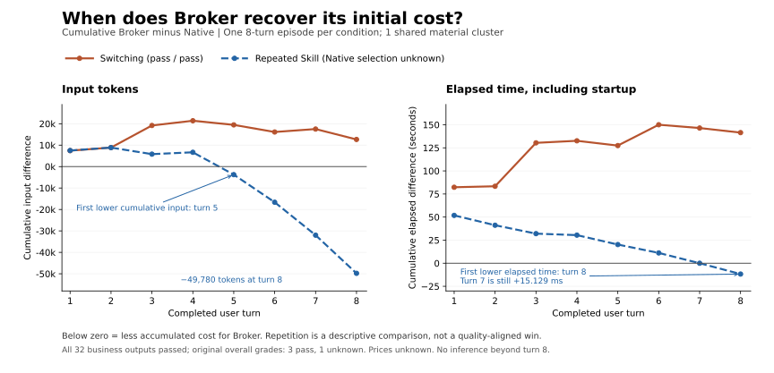

# Continuous Skill consumption: current-product diagnostic

The repeated-Skill case shows an observed recovery of Broker's initial input
premium at user turn 5, and of elapsed time at turn 8. The task-switching case
does not recover either premium within eight turns. These are two paired
observations sharing one material cluster, not a general performance estimate.

All 32 business outputs and all 12 first-required resource-file checks passed.
The original episode grades remain **3 pass, 1 unknown**: Native's repeated-Skill
episode has an unresolved legal-selection observation. Its cost curve describes
completed business work; it is not a quality-aligned adoption win.

Sources: [machine-readable results](../benchmark/results/2026-11-27-long-session-current/summary.json),
[read-only reuse instructions](../benchmark/results/2026-11-27-long-session-current/README.md),
and the retained, hash-bound receipts listed there. Implementation is tracked in
[PR #116](https://github.com/yoyooyooo/pi-context-broker/pull/116) under
[AH-1217](https://linear.app/yoyooyooo/issue/AH-1217).

## What was compared

Both conditions use the same 16 complete development Skills and the same
turn-specific business inputs. Native consumes the local Skill material through
Pi; Broker consumes the verified Notion material through its normal SDK path.
Broker may use its local material and session caches after the first access.
This is a comparison of the actual consumption paths, not a requirement that
every Broker access make a fresh Notion request.

| Property | Frozen value |
| --- | --- |
| CLI / SDK | `e2fa61517efd1c8784d2695973c4e7dbc8b18877` |
| Broker product runtime | `7f87b9242c45714f12e70b7745f9ec1a340c3655` |
| Benchmark apparatus | `a5942c90615c03b2f6e490fb5a47b2dc88ef4d14` |
| Build | `benchmark-long-session-current-20261127-1` |
| Collector | `1.3.11` |
| Declared route | `magpie/auto/gpt-6.2-sol`, thinking `high`, Code Mode `off` |
| Execution | Four continuous eight-turn episodes; one repetition per condition |
| Material | Common16; two scenarios in one shared material cluster |
| Model window | Standing authorization, starting `2026-11-27T14:50:50.322Z` |

The product commits were selected at approximately 14:34 UTC. This explicitly
paired the accepted standalone SDK with the accepted Broker runtime; Broker's
then-current dependency pin still named the preceding CLI. Product PR #110
subsequently merged to `next` at 14:51:26 UTC as `05cfe498acaec4786521e2285df616eaacb3d031`.
Its new Source behavior was not in this frozen experiment. A later commit must
not inherit these results merely because it is now `next`.

The declared automatic route identifies the requested condition, not an
independently attested physical provider backend. No product runtime, daily
package, or machine configuration was changed in this Benchmark implementation.

## Two small continuous scenarios

**Repeated Skill:** eight different routing batches use Skill A in one session.
The model can reuse previously delivered instructions and resources normally;
the task does not force a reread.

**Task switching:** A → ordinary amount calculation → B → ordinary status work
→ A → B → ordinary grouping → A. The ordinary turns are self-contained. This
checks whether reuse survives intervening work and switching between Skills.

Each user prompt introduces only that turn's inputs and names a unique output.
There are no future attachments in the initial workspace. The private oracle
binds every business contract to its actual turn. A must be completely delivered
by turn 1 and B by its first required turn, turn 3. The 97 actual provider
payloads were checked for future-input and private-oracle leakage; none was
observed. The same remote Skill objects were read back through the selected SDK:
16 candidates, 25 files, valid parity, and no remote repair.

One continuous session is an episode. Its Native/Broker conditions form a pair.
The two scenarios share a material cluster. Repetitions and the 1/2/4/8 prefixes
do not create independent material samples.

## Observed cumulative costs

The plotted value is cumulative Broker minus Native. Below zero means Broker
has accumulated less of that measured quantity. Elapsed prefixes run from the
episode start through the actual turn-end event and include startup and
inter-turn work. Full episode durations below additionally include the final
postlude. Neither measure is a direct product UI latency measurement.

| Scenario / condition | Original overall | Input tokens | Output tokens | Requests | Tool calls | Full duration |
| --- | --- | ---: | ---: | ---: | ---: | ---: |
| Switching / Broker | pass | 145,469 | 1,575 | 25 | 17 | 249.367 s |
| Switching / Native | pass | 132,803 | 1,993 | 26 | 18 | 107.891 s |
| Repeated Skill / Broker | pass | 97,579 | 1,295 | 19 | 11 | 120.974 s |
| Repeated Skill / Native | **unknown** | 147,359 | 2,501 | 27 | 19 | 132.673 s |

There were 97 actual requests and 97 provider attempts, with no retry. Summed
input was 523,210 tokens and output was 7,364 tokens. These sums count actual
provider input on each request, including history presented again; they do not
mean 523,210 distinct bytes or tokens were added to a conversation.

| User-turn prefix | Switching input difference | Repeated-Skill input difference |
| --- | ---: | ---: |
| 1 | +7,445 | +7,502 |
| 2 | +8,888 | +8,870 |
| 3 | +19,183 | +5,820 |
| 4 | +21,397 | +6,676 |
| 5 | +19,467 | −3,745 |
| 6 | +16,146 | −16,616 |
| 7 | +17,522 | −31,983 |
| 8 | +12,666 | −49,780 |

The repeated-Skill input difference first becomes negative at turn 5 and stays
negative through turn 8. At eight turns it is 33.78% lower. Elapsed time first
crosses at turn 8; at turn 7 Broker is still **15.129333 ms slower**, which must
not be rounded into an earlier crossing. Full episode duration is 8.82% lower.
These remain descriptive costs because Native's original overall grade is
unknown.

The switching pair has aligned original pass/pass grades, but Broker uses 9.54%
more input and takes 2.31 times the full duration. Neither input nor elapsed time
crosses within the observed eight turns. No claim is made about turn 9 or later.

First-request input is a different quantity from first-turn cost. Broker's first
request contains **99 fewer input tokens** in each pair: 2,973 versus 3,072 for
switching, and 2,971 versus 3,070 for repetition. The complete first user turn
still costs roughly 7,500 more input tokens. The observed premium cannot be
described as simply “Broker injects a much larger default prompt.”

Verified currency prices were unavailable. Cache-read and uncached totals also
remain unknown because some attempts lack those fields; known subtotals remain
separately named in the result. Cache-write fields are unknown, not zero. Token
differences do not establish a monetary saving.

## What the model actually received

Broker's existing same-session suppression worked in these observations. In
the switching episode, the raw tool event stream contains five main-body
returns. The actual provider payloads contain the full A body once and the full
B body once; later `use` results at turns 5, 6 and 8 are `Already loaded.`.
Native makes five separate reads, leaving three A copies and two B copies in
the final payload.

In the repeated-Skill episode, Broker reads A and its resource in the first
turn, then only writes the requested outputs in turns 2–8. Native reads again
at turns 5, 6, 7 and 8, leaving five copies of A in the final payload. All three
ordinary turns in the switching case use only the business output write in
both conditions.

The 97 inspected provider payloads do not show an extra full main body in a
system/user message or a duplicate delivery of the same tool call. This narrows
[AH-1362](https://linear.app/yoyooyooo/issue/AH-1362); it does not rule out
duplication in other metadata, schema, dependency, or compaction paths. Raw
tool-return size alone would have overstated model-visible duplication here.

## Product gaps and the remaining observation boundary

Broker startup took 24.845 and 25.962 seconds, versus Native's 1.163 and 0.877
seconds. The two Broker episodes recorded 364 owned SDK HTTP attempts:

| SDK work with HTTP | Switching | Repeated Skill |
| --- | ---: | ---: |
| Directory list | 5 operations / 170 HTTP | 2 operations / 68 HTTP |
| First material consumption | 2 operations / 46 HTTP | 1 operation / 23 HTTP |
| Resource read | 2 operations / 38 HTTP | 1 operation / 19 HTTP |
| **Total** | **254 HTTP** | **110 HTTP** |

Other observed SDK operations used zero owned HTTP. These are unique operation
counts with recorded start contexts; they are not a causal attribution of all
wall time or a claim that every request is redundant. Descendant transport
outside the owned observer remains unobserved.

[AH-1360](https://linear.app/yoyooyooo/issue/AH-1360) retains the user's work on
cold-start and explicit-refresh requests. [AH-1361](https://linear.app/yoyooyooo/issue/AH-1361)
retains directory refresh frequency and reuse across operations. The switch
case gives those improvements a concrete current baseline even though repeated
body delivery is already suppressed.

Native's repeated-Skill unknown is narrower than business correctness. Its
third turn executes `pwd; ls -d output`. The command exits successfully and its
returned text does not contain a Skill body. However, the retained observation
does not prove the necessary executable, startup/environment and unchanged
directory boundary for classifying the opaque shell call as harmless inventory.
The retained run lacks the bounded directory-inventory proof defined by the
existing observation contract. Command text alone cannot supply that proof
after execution; the current collector has no automatic pass path for it.

The original unknown is therefore preserved, with no permissive classifier
patch, regrade, or extra model rerun. This measurement boundary remains part of
[AH-1221](https://linear.app/yoyooyooo/issue/AH-1221). A future formal adoption
comparison that needs that negative selection claim must collect the necessary
proof prospectively. Positive business and first-resource evidence remains
valid and separately visible.

## Reused apparatus and verification

The change extends the existing `journey` command with a `turns` view. It joins
hash-verified turn boundaries, requests, all provider attempts, output readbacks
and original grades. Missing or unattributed usage stays unknown. The two new
scenarios use the existing corpus, fixture, isolation, capture, standing runner,
ledger and collector. Read-only fixture rebinding verifies complete Skill
object equality before adding new business cases.

Focused verification covered 48 evidence/turn-view tests, 19 fixture tests and
13 diagnostic/snapshot tests. Independent checks recomputed all 32 business
outputs, verified the 12 first-required file deliveries, inspected all actual
payloads, and preserved the original grades. The selected frozen pair passed
its final paired check before retirement. CI validates both declared Node
versions through PR #116.

Offline reuse also checked eight historical episodes with zero model calls.
The old eight-turn SDK2 / Code Mode free case crosses in input at turn 5, with
112,725 versus 159,657 total input tokens, but never crosses in elapsed time
when startup is included. Its condition differs from this experiment; the
[historical projection](../benchmark/results/2026-11-27-long-session-current/historical-context.json)
is kept separate and is not pooled with the current pair.

Preparation used eight captures with zero model sends and 136 owned SDK HTTP
attempts. The first four captures belong to a retained setup attempt rejected
for a six-digit timestamp where the existing protocol requires millisecond
UTC. The corrected declaration received a new setup and plan; the validator
was not weakened. The material readback used zero model calls and no repairs;
its HTTP count was not independently quantified and is not reported as zero.

## Closeout and the next use

The standing ledger ended at 249 observations / 35 registrations, with no live
lease. After all consumers and the final paired check completed, 70 exact owned
paths were moved to the native system Trash: 49 test temporary directories,
3 build dependency/cache paths, and 18 run compilation caches. Six optional
paths were already absent. The removed active allocation was 642,704 KiB;
same-volume Trash movement has **zero credited physical free-space benefit**.

All 33,562 inventoried original entries remained unchanged. Raw payloads,
grades, readbacks, complete packages, SDK/controller, material proofs, plans and
ledger remain available. Seven npm diagnostics were retained separately. The
frozen build is now **evidence_only**: its 30 source dependency links point into
retired dependencies, so a complete build-check or replay is not promised.
Read-only query and journey are the supported reuse path.

An independent Agent starting only from the result README ran the query and all
four journeys after retirement. All five commands succeeded and reproduced the
earlier stdout hashes, original grades and cumulative curves with zero Benchmark
model calls. This verifies bounded read-only recovery on Mini; it does not stand
in for the broader unfamiliar-Agent end-to-end pilot or portable replay.

The next comparison should follow an accepted product change that could alter
the observed costs or consumption behavior, using these same small scenarios
and original quality boundaries. Select and freeze the then-current product
pair, refresh only stale material proof, and compare the relevant journey. A
full historical matrix or a new runner is not required to answer that question.
