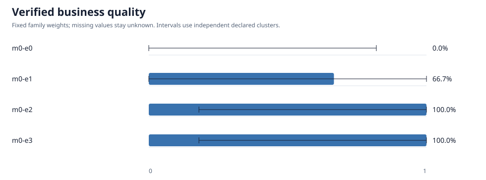

# 工程诊断结果：34 条闭合观察，store-fault 8 条待续

2026-11-25，本轮 42 项工程计划已得到 **34 条真实闭合观察，覆盖六个 scope**：CodeMode 四条件共 24 条，以及五个规模／多轮对照各 2 条。34 条的业务产物检查全部 pass；加上适用合同后，逐条状态为 **21 pass、2 fail、11 unknown**。这些是证据清点数，六个 scope 保留各自分母、权重、区间与决策，不合并成一个总质量率。

原计划的 store-fault 8 条尚未运行模型。材料准备中的未知写入原件已保留，后续新材料的 8 条执行将另立链路。此前第一轮只完成的 **1/24** 另存于[首次部分结果](../benchmark/results/2026-11-25-standing-partial-run1/README.md)，保留原 controller 与条件 epoch；不将它补入本轮 34 条，也不把两轮写成“35/42 已完成”。

## 实际范围与条件

P / F / U 分别表示完整验收的 pass / fail / unknown。完整验收同时要求业务产物与适用合同；“业务 pass”这一列只清点产物结果。

| 设计与 canonical 报告 | 本轮计划 | 实际闭合 | 业务 pass | 完整 P / F / U |
|---|---:|---:|---:|---:|
| [CodeMode 四条件](../benchmark/results/2026-11-25-standing-engineering34/packages/standing42-run-2-codemode-24/report.md) | 24 | 24 | 24 | 16 / 1 / 7 |
| [Implicit · 64 候选 · 1 轮](../benchmark/results/2026-11-25-standing-engineering34/packages/standing42-run-2-scale-implicit-n64-r1/report.md) | 2 | 2 | 2 | 2 / 0 / 0 |
| [Implicit · 256 候选 · 1 轮](../benchmark/results/2026-11-25-standing-engineering34/packages/standing42-run-2-scale-implicit-n256-r1/report.md) | 2 | 2 | 2 | 1 / 0 / 1 |
| [References · 16 候选 · 2 轮](../benchmark/results/2026-11-25-standing-engineering34/packages/standing42-run-2-scale-references-n16-r2/report.md) | 2 | 2 | 2 | 1 / 0 / 1 |
| [References · 16 候选 · 4 轮](../benchmark/results/2026-11-25-standing-engineering34/packages/standing42-run-2-scale-references-n16-r4/report.md) | 2 | 2 | 2 | 0 / 1 / 1 |
| [Tariff · 16 候选 · 8 轮](../benchmark/results/2026-11-25-standing-engineering34/packages/standing42-run-2-scale-tariff-n16-r8/report.md) | 2 | 2 | 2 | 1 / 0 / 1 |
| store-fault · clean/fault × 两产品 × 两 journey | 8 | 0 | — | 未运行 |

六个已运行 scope 均为 `phase=pilot`、`purpose=environment_iteration`，使用 development 材料，模型路由为 `auto/gpt-6.2-sol`，API 为 `openai-completions`，`thinkingLevel=medium`、每请求 `maxTokens=4096`。路由保留实际报告模型与配置绑定；auto 路由的底层身份仍按原协议记录为 opaque alias。这些结果不构成未见材料上的正式 native 校准。

已运行的 Broker/native 条件使用同一个 `benchmark-own-candidate-standing-1` 产品构建，CLI commit `992736a152e0f47d451013cd05609c1866525ba8`、Broker commit `d1f41394aeea281ee189a90eed5bd16c7e658456`；它们比较消费方式，不是本轮另做了一次 reference/candidate 产品迭代比较。各组的材料、环境、模型参数、初态和来源指纹保留在各自 `analysis-input.json` 的 protocol 中。[CodeMode 协议与观察](../benchmark/results/2026-11-25-standing-engineering34/packages/standing42-run-2-codemode-24/analysis-input.json)

CodeMode 的六个 journey 为 explicit、implicit、references、scripts/assets、complementary、continuation；各条件执行相同六个逻辑 cluster。前五类为 1 轮，continuation 为 2 轮，候选目录规模为 16。条件在执行前固定为 Broker/native × free/off，未按模型事后是否实际调用 CodeMode 重新分组。本轮没有 required 条件。

## CodeMode 四条件

下表沿用 canonical `conditions.csv`。输入为按固定权重计算的每 episode 总 input 均值；capped-time 的含义见下一节。区间是本 scope 的 **95% simultaneous cluster Hoeffding 区间**，不能当作跨六个 scope 的总体区间。

| 条件 | 消费方式与政策 | 计划／有效 | P / F / U | Verified quality | 95% 区间 | 平均总 input | Capped-time（秒） |
|---|---|---:|---:|---:|---|---:|---:|
| m0-e0 | broker-free | 6 / 6 | 0 / 1 / 5 | 0.0% | [0.0%, 81.9%] | 21,613.0 | 180.000 |
| m0-e1 | native-free | 6 / 6 | 4 / 0 / 2 | 66.7% | [0.0%, 100.0%] | 20,974.7 | 72.380 |
| m0-e2 | broker-off | 6 / 6 | 6 / 0 / 0 | 100.0% | [18.1%, 100.0%] | 20,074.0 | 36.950 |
| m0-e3 | native-off | 6 / 6 | 6 / 0 / 0 | 100.0% | [18.1%, 100.0%] | 17,741.7 | 23.599 |

[条件 CSV](../benchmark/results/2026-11-25-standing-engineering34/packages/standing42-run-2-codemode-24/conditions.csv) · [配对 CSV](../benchmark/results/2026-11-25-standing-engineering34/packages/standing42-run-2-codemode-24/comparisons.csv) · [交互 CSV](../benchmark/results/2026-11-25-standing-engineering34/packages/standing42-run-2-codemode-24/interactions.csv)

每一行下面的比较方向都是 Broker − native，input/time 比值则为 Broker ÷ native；每项有六个配对单位。

| 政策 | 质量差 | 95% 同时区间 | Input 比值 | Capped-time 比值 | 原分析决策 |
|---|---:|---|---:|---:|---|
| free | -66.7 pp | [-100.0, 97.2] pp | 1.0304 | 2.4869 | rejected / critical_contracts |
| off | 0.0 pp | [-100.0, 100.0] pp | 1.1315 | 1.5657 | descriptive / no_acceptance_claim |

free 下的 Broker 观察含一个 critical 合同 fail，因此原分析在 `critical_contracts` 阶段记为 rejected；off 的结果是 descriptive，不作采纳或非劣结论。free/off 的质量交互估计为 −66.7 个百分点，但区间为 [−200, 200] 个百分点；这六个 cluster 无法支持关于 CodeMode 普遍优劣的窄结论。Input 比值没有可用的推断区间，不能由点估计宣称非劣。



现有[输入图](../benchmark/results/2026-11-25-standing-engineering34/packages/standing42-run-2-codemode-24/input.svg)与[成功时间图](../benchmark/results/2026-11-25-standing-engineering34/packages/standing42-run-2-codemode-24/time.svg)使用同一分析输出。

### Capped-time 不是原始时延

这个指标衡量在固定分析视野内取得“业务与适用合同均已验证成功”的时间。验证成功时取成功边界时间并按 τ 截断；没有验证成功的观察按 τ 计入。本组 τ=180 秒，五个规模／多轮组 τ=600 秒。τ 是分析定义，不是本轮运行的停止预算。

因此，Broker-free 的 180 秒不表示六次请求都真实运行了 180 秒；unknown 也不因采用这一保守计分而变成观察到的 fail。原始 `timing.duration_ms` 与 `timing.time_to_success_ms` 仍分别留在每条 normalized observation 中。例如 256 候选的 Broker 观察真实 duration 为 58.892 秒，完整结果为 unknown，故 capped-time 为 600 秒。下表将原始 duration 与这个成功度量分列，避免混用。

## 五个规模与多轮对照

这五组均为 Broker-free 与 native-free；表中成对数字依次为 Broker / native。每组只有一个逻辑 cluster、两个条件各一条观察。两侧每项 quality 区间都为 [0%, 100%]，配对质量差区间都为 [−100, 100] 个百分点。增加回合数没有增加独立 cluster。

| 设计 | 完整结果 B / N | 总 input B / N | 原始 duration 秒 B / N | Capped-time 秒 B / N | Input B/N | 决策 |
|---|---|---:|---:|---:|---:|---|
| [Implicit · 64 候选 · 1 轮](../benchmark/results/2026-11-25-standing-engineering34/packages/standing42-run-2-scale-implicit-n64-r1/report.md) | P / P | 27,252 / 38,131 | 36.035 / 18.614 | 36.005 / 18.596 | 0.7147 | descriptive |
| [Implicit · 256 候选 · 1 轮](../benchmark/results/2026-11-25-standing-engineering34/packages/standing42-run-2-scale-implicit-n256-r1/report.md) | U / P | 67,811 / 125,212 | 58.892 / 23.992 | 600.000 / 23.910 | 0.5416 | descriptive |
| [References · 16 候选 · 2 轮](../benchmark/results/2026-11-25-standing-engineering34/packages/standing42-run-2-scale-references-n16-r2/report.md) | U / P | 39,419 / 41,859 | 52.293 / 40.465 | 600.000 / 40.379 | 0.9417 | descriptive |
| [References · 16 候选 · 4 轮](../benchmark/results/2026-11-25-standing-engineering34/packages/standing42-run-2-scale-references-n16-r4/report.md) | F / U | 76,702 / 104,078 | 135.055 / 88.670 | 600.000 / 600.000 | 0.7370 | rejected |
| [Tariff · 16 候选 · 8 轮](../benchmark/results/2026-11-25-standing-engineering34/packages/standing42-run-2-scale-tariff-n16-r8/report.md) | U / P | 112,725 / 159,657 | 131.321 / 112.510 | 600.000 / 112.391 | 0.7060 | descriptive |

`references` 四轮组的 Broker 观察触发 critical 合同 fail，故该组为 rejected；其余四组为 descriptive。256 候选和多轮组的 input 点估计不能单独证明质量非劣或资源优势；这些组的完整证据状态与宽区间必须一同读取。

## 两个 critical fail 与十一条 unknown

两个 fail 均为 **`grant-chain-read`**，原判定理由是“未观察到完整合法的资源读取路径”。对应业务产物都正确，但这不足以替代所要求的资源链证据。失败定位如下：

| 观察 | 条件 | 合同 | 公开 trace 与判定 |
|---|---|---|---|
| `standing42-run-2-codemode-24-016` | Broker-free；references 1 轮 | grant-chain-read / fail | [events](../benchmark/results/2026-11-25-standing-engineering34/packages/standing42-run-2-codemode-24/raw/b59c0fb58dba5425a89a038e766c1f99c7f64f0a05dc2fc8bcd5d68b3d5a1840) · [readback](../benchmark/results/2026-11-25-standing-engineering34/packages/standing42-run-2-codemode-24/raw/31c6027eef8c2c7b81ab51f0b3cee1e3a20869cdfc61e3bf47e2b8062ec65588) · [grade](../benchmark/results/2026-11-25-standing-engineering34/packages/standing42-run-2-codemode-24/raw/45bd4fe917b2bf8db920df2eed1e8df79f2423973ba64712e91a7cc79f9244a7) |
| `standing42-run-2-scale-references-n16-r4-001` | Broker-free；references 4 轮 | grant-chain-read / fail | [events](../benchmark/results/2026-11-25-standing-engineering34/packages/standing42-run-2-scale-references-n16-r4/raw/2656c899389a60fd454cb777ebfb5340c296c536e55566a6dfb1732bd1659609) · [readback](../benchmark/results/2026-11-25-standing-engineering34/packages/standing42-run-2-scale-references-n16-r4/raw/c7b83fd62ddde2b44f358d1ae7eceb61e9244f0c61728ff6ab282e93fc8634e1) · [grade](../benchmark/results/2026-11-25-standing-engineering34/packages/standing42-run-2-scale-references-n16-r4/raw/914489798ad6c0db74649da22d71f4da3d0788877bbc9ce85bb58a5dc02daafe) |

十一条 unknown 保持 unknown。相关合同包括不完整的 `legal-selection` 证据，以及未能闭合的完整合法资源读取证据。合同 unknown 数与 episode unknown 数不相等，同一 episode 可以含多个未闭合合同。Verified quality 对 unknown 不给成功分；它们既没有被宣称通过，也没有被改记成已知失败。六个已完成 scope 的 34 条 admission 均为 valid，invalid 为 0；未运行的 store-fault 8 条单独保留，不混成这些 scope 的已观察 unknown。

## 资源账务

下列用量逐条保留失败和 unknown 观察的实际消耗。34 条本轮观察的输入、输出用量字段均已观测，合计 **226 次模型 HTTP 请求、1,275,266 input tokens、20,583 output tokens**。各组金额仍为 unknown；配置中的零价格占位没有被当作免费调用。

| 范围 | 已知模型请求 | 已知 input | 已知 output | 金额 |
|---|---:|---:|---:|---|
| CodeMode 四条件 | 116 | 482,420 | 10,002 | unknown |
| Implicit · 64 候选 · 1 轮 | 8 | 65,383 | 623 | unknown |
| Implicit · 256 候选 · 1 轮 | 9 | 193,023 | 639 | unknown |
| References · 16 候选 · 2 轮 | 17 | 81,278 | 1,729 | unknown |
| References · 16 候选 · 4 轮 | 32 | 180,780 | 3,210 | unknown |
| Tariff · 16 候选 · 8 轮 | 44 | 272,382 | 4,380 | unknown |
| 本轮 34 条，用量清点 | 226 | 1,275,266 | 20,583 | unknown |
| 第一轮保留的 1/24 观察，另链 | 4 | 16,194 | 269 | unknown |
| 四次连接诊断，非 benchmark 样本 | 4 | 1,788 | 412 | unknown |

首次部分观察为 Broker-off、`scripts-assets-02-a-n16-r1`。它保留在原 24 格 CodeMode 分母中，另 23 格未启动；原第一轮 42 项计划有 41 格未启动。[部分结果说明与复算](../benchmark/results/2026-11-25-standing-partial-run1/README.md)

四次连接诊断有三次成功，四次用量均已记录；它们不是四条科学样本，也未写入先导科学 ledger。其汇总原件指纹为 `99bd4c9ff32630ea32a6334ad2d312c49b4a8b2590a5f8e602efa3ec29df518b`。上述新用量没有覆盖、补齐或改写历史未知成本。

## 尚未运行的 store-fault 8 条

第 002 个 fixture 的 native 主文准备遇到实际 round-trip 差异：Notion 给正文中的纯文本资源路径 `references/eligibility.md` 增加了外链，完整读回比较判为 `different`，公共 CLI 返回 `WRITE_OUTCOME_UNKNOWN / CURRENT_NATIVE_ROUNDTRIP`。使用原输入和同一 operation 恢复一次后仍为 unknown，原输入没有改写，随后停止该 owner 的继续写入。此准备与恢复没有模型调用，不能计作 store-fault 业务运行。

原准备结果与一次恢复的历史指纹分别为 `483ed5ea467933a6a2b1dd8ea2ed3bec5af9b8d831a668cedc642de3d1fa6436`、`11e9bba2e52a30a0321be9f8b5e4fd5f28f8fee9fc85f96980e0de64f65c37fb`。新 development 材料仅给 grant 主文中的既有资源路径增加两个 Markdown 代码标记字符。独立新 owner 的单一 Skill 四文件 canary 已通过：主文由原公共 SDK 判为结构等价，三个资源文件的原字节完全相同，原 materialization API 给出 4/4 parity valid。这个 canary 不代表完整 16 候选科学 fixture 或后续 8 条模型运行完成。原 001/002、旧 unknown 和原比较器均保留；后续 8 条沿新材料与执行身份另链。

发布阶段修复了预约序号关联检查，随后对原预约 106–139 的 34 条观察完成实际离线核验；原执行、评分和成本均未改变。

## 与历史交付的关系

历史 104 条结果继续使用原公开 raw 链。已合入的[历史对照 census](../benchmark/results/2026-11-25-retained-evidence-census/README.md)记录零模型 reanalysis：13 条 unknown 由已有证据恢复为 pass；14 条 fail、11 条 invalid、6 条完整 usage unknown 均保留。历史仍分 16 层，不与本轮六组池化。[逐条 census](../benchmark/results/2026-11-25-retained-evidence-census/census.json) · [口径与复算说明](benchmark-retained-evidence-census-2026-11-25.md)

历史成本保留两个明确口径：完整 episode 字段之和为 2,402,549 input / 63,085 output；包含部分 episode 内已知成功请求的下界为 2,406,425 / 63,121。已知请求 476，六条完整用量仍未知，金额未知。两种已知小计不替代原账务锚。

此前两真实自有产品版本的共同业务比较已保留 **原计划 20 格与 3+6+3+8 四个实际身份层**。最后 Own8 包含四组条件内有效配对，主分析仍保留科学分母 20，其余 12 格在该主分析中列为 unresolved，不意味着原 20 格在物理执行上都未完成。对照的正式结论为 **inconclusive**；两版本比较按原分母、四层身份和这一有限结论收口。

直接证据为 [Own20 原格 lineage](../benchmark/results/2026-11-25-observer-repair-continuation/own20-lineage.json)、[Own8 主报告](../benchmark/results/2026-11-25-observer-repair-continuation/packages/own-product-observer-repair-unstarted-8-3/report.md)与[主分析](../benchmark/results/2026-11-25-observer-repair-continuation/packages/own-product-observer-repair-unstarted-8-3/analysis.json)。较早三层沿 lineage 链接至[固定历史发布](https://github.com/yoyooyooo/pi-context-broker/tree/65121fb82fe9b0ac6a0c7f722fe3b8284f982fab/benchmark/results/2026-11-24-own-provider-stop89)。这项产品版本比较与仍待完成的首次正式 native 校准、required 诊断、普通自动发现和 local/Notion 混合兼容分别验收。

## 文件、图表与离线复算

所有表格来自既有 canonical 分析与 CSV；图使用原生成的 SVG。逐组入口如下：

| Scope | 公开文件 |
|---|---|
| CodeMode 四条件 | [报告](../benchmark/results/2026-11-25-standing-engineering34/packages/standing42-run-2-codemode-24/report.md) · [条件表](../benchmark/results/2026-11-25-standing-engineering34/packages/standing42-run-2-codemode-24/conditions.csv) · [配对表](../benchmark/results/2026-11-25-standing-engineering34/packages/standing42-run-2-codemode-24/comparisons.csv) · [质量图](../benchmark/results/2026-11-25-standing-engineering34/packages/standing42-run-2-codemode-24/quality.svg) · [输入图](../benchmark/results/2026-11-25-standing-engineering34/packages/standing42-run-2-codemode-24/input.svg) · [成功时间图](../benchmark/results/2026-11-25-standing-engineering34/packages/standing42-run-2-codemode-24/time.svg) · [raw 映射](../benchmark/results/2026-11-25-standing-engineering34/packages/standing42-run-2-codemode-24/public-manifest.json) · [复算](../benchmark/results/2026-11-25-standing-engineering34/packages/standing42-run-2-codemode-24/replay.mjs) |
| Implicit · 64 候选 · 1 轮 | [报告](../benchmark/results/2026-11-25-standing-engineering34/packages/standing42-run-2-scale-implicit-n64-r1/report.md) · [条件表](../benchmark/results/2026-11-25-standing-engineering34/packages/standing42-run-2-scale-implicit-n64-r1/conditions.csv) · [配对表](../benchmark/results/2026-11-25-standing-engineering34/packages/standing42-run-2-scale-implicit-n64-r1/comparisons.csv) · [质量图](../benchmark/results/2026-11-25-standing-engineering34/packages/standing42-run-2-scale-implicit-n64-r1/quality.svg) · [输入图](../benchmark/results/2026-11-25-standing-engineering34/packages/standing42-run-2-scale-implicit-n64-r1/input.svg) · [成功时间图](../benchmark/results/2026-11-25-standing-engineering34/packages/standing42-run-2-scale-implicit-n64-r1/time.svg) · [raw 映射](../benchmark/results/2026-11-25-standing-engineering34/packages/standing42-run-2-scale-implicit-n64-r1/public-manifest.json) · [复算](../benchmark/results/2026-11-25-standing-engineering34/packages/standing42-run-2-scale-implicit-n64-r1/replay.mjs) |
| Implicit · 256 候选 · 1 轮 | [报告](../benchmark/results/2026-11-25-standing-engineering34/packages/standing42-run-2-scale-implicit-n256-r1/report.md) · [条件表](../benchmark/results/2026-11-25-standing-engineering34/packages/standing42-run-2-scale-implicit-n256-r1/conditions.csv) · [配对表](../benchmark/results/2026-11-25-standing-engineering34/packages/standing42-run-2-scale-implicit-n256-r1/comparisons.csv) · [质量图](../benchmark/results/2026-11-25-standing-engineering34/packages/standing42-run-2-scale-implicit-n256-r1/quality.svg) · [输入图](../benchmark/results/2026-11-25-standing-engineering34/packages/standing42-run-2-scale-implicit-n256-r1/input.svg) · [成功时间图](../benchmark/results/2026-11-25-standing-engineering34/packages/standing42-run-2-scale-implicit-n256-r1/time.svg) · [raw 映射](../benchmark/results/2026-11-25-standing-engineering34/packages/standing42-run-2-scale-implicit-n256-r1/public-manifest.json) · [复算](../benchmark/results/2026-11-25-standing-engineering34/packages/standing42-run-2-scale-implicit-n256-r1/replay.mjs) |
| References · 16 候选 · 2 轮 | [报告](../benchmark/results/2026-11-25-standing-engineering34/packages/standing42-run-2-scale-references-n16-r2/report.md) · [条件表](../benchmark/results/2026-11-25-standing-engineering34/packages/standing42-run-2-scale-references-n16-r2/conditions.csv) · [配对表](../benchmark/results/2026-11-25-standing-engineering34/packages/standing42-run-2-scale-references-n16-r2/comparisons.csv) · [质量图](../benchmark/results/2026-11-25-standing-engineering34/packages/standing42-run-2-scale-references-n16-r2/quality.svg) · [输入图](../benchmark/results/2026-11-25-standing-engineering34/packages/standing42-run-2-scale-references-n16-r2/input.svg) · [成功时间图](../benchmark/results/2026-11-25-standing-engineering34/packages/standing42-run-2-scale-references-n16-r2/time.svg) · [raw 映射](../benchmark/results/2026-11-25-standing-engineering34/packages/standing42-run-2-scale-references-n16-r2/public-manifest.json) · [复算](../benchmark/results/2026-11-25-standing-engineering34/packages/standing42-run-2-scale-references-n16-r2/replay.mjs) |
| References · 16 候选 · 4 轮 | [报告](../benchmark/results/2026-11-25-standing-engineering34/packages/standing42-run-2-scale-references-n16-r4/report.md) · [条件表](../benchmark/results/2026-11-25-standing-engineering34/packages/standing42-run-2-scale-references-n16-r4/conditions.csv) · [配对表](../benchmark/results/2026-11-25-standing-engineering34/packages/standing42-run-2-scale-references-n16-r4/comparisons.csv) · [质量图](../benchmark/results/2026-11-25-standing-engineering34/packages/standing42-run-2-scale-references-n16-r4/quality.svg) · [输入图](../benchmark/results/2026-11-25-standing-engineering34/packages/standing42-run-2-scale-references-n16-r4/input.svg) · [成功时间图](../benchmark/results/2026-11-25-standing-engineering34/packages/standing42-run-2-scale-references-n16-r4/time.svg) · [raw 映射](../benchmark/results/2026-11-25-standing-engineering34/packages/standing42-run-2-scale-references-n16-r4/public-manifest.json) · [复算](../benchmark/results/2026-11-25-standing-engineering34/packages/standing42-run-2-scale-references-n16-r4/replay.mjs) |
| Tariff · 16 候选 · 8 轮 | [报告](../benchmark/results/2026-11-25-standing-engineering34/packages/standing42-run-2-scale-tariff-n16-r8/report.md) · [条件表](../benchmark/results/2026-11-25-standing-engineering34/packages/standing42-run-2-scale-tariff-n16-r8/conditions.csv) · [配对表](../benchmark/results/2026-11-25-standing-engineering34/packages/standing42-run-2-scale-tariff-n16-r8/comparisons.csv) · [质量图](../benchmark/results/2026-11-25-standing-engineering34/packages/standing42-run-2-scale-tariff-n16-r8/quality.svg) · [输入图](../benchmark/results/2026-11-25-standing-engineering34/packages/standing42-run-2-scale-tariff-n16-r8/input.svg) · [成功时间图](../benchmark/results/2026-11-25-standing-engineering34/packages/standing42-run-2-scale-tariff-n16-r8/time.svg) · [raw 映射](../benchmark/results/2026-11-25-standing-engineering34/packages/standing42-run-2-scale-tariff-n16-r8/public-manifest.json) · [复算](../benchmark/results/2026-11-25-standing-engineering34/packages/standing42-run-2-scale-tariff-n16-r8/replay.mjs) |

每组还保留 `budget_curves.csv`、`paired_budgets.csv`、`transitions.csv` 与 `cost_frontier.csv`。`analysis-input.json` 中的每条合同引用关联 artifact ID、JSON pointer 或 JSONL 行号，再由 `artifacts` 与 `public-manifest.json` 定位公开 raw 文件。

从仓库根目录使用 Node26，为每次复算选一个尚不存在的输出目录，例如：

```sh
node benchmark/results/2026-11-25-standing-engineering34/packages/standing42-run-2-codemode-24/replay.mjs \
  --out /absolute/new-codemode24-report

node benchmark/results/2026-11-25-standing-partial-run1/package/replay.mjs \
  --out /absolute/new-partial-run1-report
```

其余五组使用各自包内的同名入口，保持各自固定分母。历史小型 census 使用不同入口：

```sh
node benchmark/results/2026-11-25-retained-evidence-census/recompute.mjs \
  --manifest-sha256 83650b150a2be19084da4505d067f8e11e3c843b15b1edf06815bca29d70bace \
  --out /absolute/new-history-census
```

本轮原 collector 为 `1.2.0`，源码 SHA-256 `d1603000b6bf48184688a056bf05f8fa2fa03e7edec2d93b58e33e7db51473ef`；normalizer 与 analysis 均为 `1.1.0`。各公开包使用 sanitizer `1.0.6`，manifest 同时保留原件指纹、公开副本指纹与不变分析含义的绑定。

公开 replay 验证脱敏文件哈希和证据定位，并从保留的 normalized observations 重算统计。它不会运行私有 grader、还原因脱敏改变的私有 raw 哈希链、调用模型或产生新观察。历史 census 的小入口只复算逐条 census 的算术与差异；它没有重新公开重放 104 条私有 grader。当前交付保留已完成工程观察及未完成项，不宣称整个验收链已经完成。

## 本次实际复算记录

六个公开包已于 2026-11-25 19:03（Asia/Manila）完成隔离复算。过程没有继承凭据，操作系统拒绝网络、私有源文件读取、私有写入及公开副本写入。六组分析、CSV 表格和质量图按原字节匹配；input/time 图仅有已记录的标题措辞差异。公开包及原导出字节保持不变，新增模型请求为 0。首次 1/24 部分结果也已独立完成同类复算。

[实际复算摘要](benchmark-standing-engineering-2026-11-25-replay.json)包含公开 manifest 指纹、逐包结果、隔离检查与成本核对，不包含私有路径或凭据。
