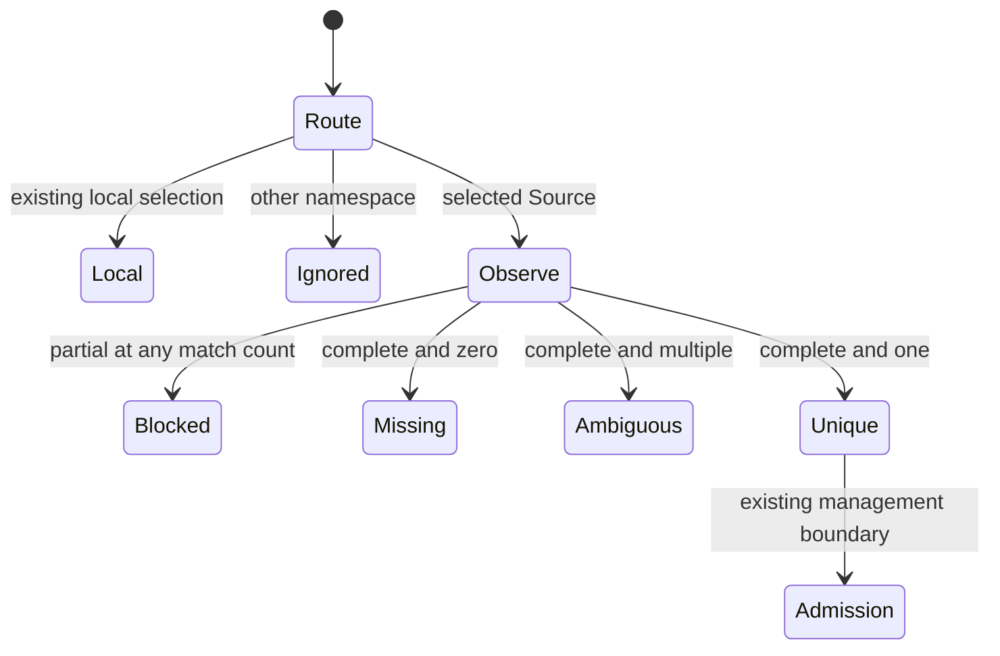

# Consumer state

Owner: [.agents/skills/verify-notion-consumer-state](../../../.agents/skills/verify-notion-consumer-state/SKILL.md).

These seven bounded contracts complement Availability/ReadRace. The complete case inventory and independent expected rules live in `coverage.json`. Candidates must satisfy every declared rule and NoDeadlock. Each negative must break exactly its declared set. Parse errors, timeouts, incomplete spaces and unknown outcomes fail.

| Model | Contract | Independent implementation checks |
| --- | --- | --- |
| FreshnessPublication | Original validation/expiry, remote/cache/fixed/unknown evidence, request/lifecycle/identity publication and exact failure target | Controlled clock, equal-time order, F1–F7 and source/target guards |
| SelectionGraph | Validate identity, budget and complete root/Requires before final selection; independent member pins | Failed refresh, budget, mixed vectors, early commit and pin mutations |
| DeliveryBoundary | Provider acceptance, complete source proof, turn completion, host draft decision and actual projection ACK | Registered hooks, discarded drafts, session/rewind identities and receipt guards |
| RecoveryClosure | Original fixed bodies, mandatory closure, local failure isolation and three subsequent prompts | Missing/disabled/denied originals, late restores and continued conversation |
| LibrarySession | Branch Library choice, admitted-turn binding, exact call target, directory publication ticket and original pin owner | Switch/failure/branch restoration, A-to-B late producers, canonical root routing and old A selections |
| MenuPublication | Current denial, snapshot order, dismissed dropdown and highlighted candidate identity | Pure snapshot publication, displayed-item acceptance, real Pi Editor and independently accepted input receipts |
| SourceMemberSelection | Preserve an existing local selection and the selected namespace; require complete discovery before classifying zero, one or multiple Source matches | Mixed-source host routing, exact incomplete-directory warning with no management, and qualified actual Pi first use with a different local body |

Read the Skill's contracts reference for atomic boundaries and finite assumptions. Hashes bind reviewed implementation bytes; they do not establish full implementation refinement. Fixed pins describe verified local selections, not remote version management or guaranteed historical recovery.

Run the Skill's doctor and full run from the repository root with the pinned statechart/TLC installation. Keep outputs outside the repository. The existing runner supports `--suite consumer-state` and `--model FreshnessPublication`, `SelectionGraph`, `DeliveryBoundary`, `RecoveryClosure`, `LibrarySession`, `MenuPublication` or `SourceMemberSelection` for a targeted investigation.

`DeliveryBoundary.providerAccepted` denotes logical headers, not a wire receipt. Actual source roles, directory counts, JSON schemas, body completeness and HTTP entity digests remain concrete regression obligations. `final-request-undici.test.ts` checks real Node HTTP entities; installed Pi serializer and live provider behavior belong to the separate integration scope and must be executed before claiming them.

## Library selection

LibrarySession has eleven configurations. The complete suite has fifty-one,
including five MenuPublication and four SourceMemberSelection configurations.
Its independent oracle preserves the admitted A turn, A directory payload, parent
branch selection and original A pin while the current child branch selects B.
The selection ticket and lifecycle epoch are separate. A valid switch affects
later turns, keeps the current turn bound, and does not cancel or disable A.
An unsuccessful switch blocks the requested B flow while preserving the prior
selection; that flow cannot silently continue in A.

An explicit B reference can be used from an A turn without changing the branch
default. An independently supplied conflicting explicit call scope is rejected.
Directory publication checks the producer's original scope, selection ticket and
lifecycle epoch. A response admitted under A cannot become B directory evidence.
Rewinding or returning to a parent branch restores that branch's stored selection,
even when a later child selected B.

The finite domain has two roots, two branches, an admitted turn and a later turn,
one directory producer, one selection change and one independent cancellation.
Validation, selection commit, branch restoration, return and turn admission are
separate transitions. `SessionFlowEventuallyExplained` assumes started actions
and external observations terminate under weak fairness. A rejection is an
explained outcome; this is not eventual service availability or provider success.

The concrete owner is `library-selection.ts`: active-branch reduction, fresh
input admission, local default capture, remote root verification, failed-switch
blocking and publication identity. `host-skills.ts` retains the admitted context
for the running turn independently of content preparation and queued input.
Six `library-*` mutations in `check-consumer-state-mutations.mjs` remove these
actual guards. Each requires an unmodified passing baseline, an assertion-level
behavior failure, and a passing replay after exact restoration. Coverage hashes
record reviewed correspondence; the retained run reports establish execution.

The model covers the primary branch default and one explicit cross-Library call.
It does not enumerate multiple explicit `$name@source` invocations in one turn.
Those names select configured Sources and keep each actual root/full reference;
unqualified names use only the selected default. Concrete UUID/URL parsing,
enabled Source routing, mixed Prompt/Skill injection, actual Pi branch
serialization and installed CLI arguments remain separate implementation checks.

## Menu publication and input admission

MenuPublication is the reproducible implementation-review slice for AH-1322.
It retains the four reviewed properties and their independent single-guard
negative cases. Its source is maintained here; the earlier 18-state design run
is historical evidence, not the state count or provenance of this model.

The finite domain has one scope and an already-open dropdown with B highlighted,
one cache return, one fresh return, one screen update per changed snapshot and
one Escape or acceptance. The known-denial scenario starts with a newer refusal
of A than the stored cache; the reorder scenario has no denial. Snapshot
publication and screen publication are separate actions, so acceptance can occur
between them. Each publication either honors the original highlighted identity
or, in the negative, reuses its old ordinal. No fairness or latency property is
claimed. Cold/partial/empty snapshots, arbitrary source changes, removed
highlights and noncooperative Promises remain concrete regression obligations.

`completion-candidates.ts` owns ordered in-memory snapshot admission. The SDK's
pure local reader supplies denial-filtered candidates and remains an independent
consumer boundary. `pi-dollar-editor.ts` owns the intent, input/cursor and scope
ticket, request generation, dismissal and highlighted identity. `dollar.ts`
accepts the actual displayed candidate rather than looking its label up again.
`accepted-selections.ts` consumes that draft choice into a synchronous
`InputReceipt`; `host-skills.ts` prepares ordinary and queued inputs under each
receipt's Library and session. A candidate still grants no consumption authority,
complete body, selected graph or provider-delivery proof.

Queued images are normalized before Pi emits `message_start`. The receipt is
associated with that native occurrence and later adopted through the original
`SessionEntry.message` instance, because `emitContext` clones its messages.
`pi-queued-input.test.ts` replays these actual installed host methods, including
real image resizing and repeated context. Image bytes, host object identity and
arbitrary queues remain outside the finite model.

## Source member selection

`SourceMemberSelection` starts with one admitted literal, the ordinary registry's
local selection result, the selected Source namespace, a decoded complete or
partial member directory, and zero, one or multiple matching candidates. Its
twenty-four initial combinations do not enumerate aliases, filesystem scanning,
credentials, Git subprocesses or asynchronous network responses.

Route, observation, classification and management admission are separate actions.
An existing local selection ends this route before Source discovery. A different
namespace is ignored. For the selected Source, partial coverage blocks every
match count; even zero matches cannot establish absence. Only a complete unique
match reaches management admission. That state permits entry into the existing
management boundary; it does not prove a dispatch, its receipt, remote writes,
content preparation or delivery. Other lifecycle and authorization guards are
outside this model. No fairness or service availability property is claimed.

The following is an implementation statechart, not a generated TLC graph:

`index.discoverInputMembers` preserves a result already found by the ordinary
registry. `completion-candidates.matchSourceMemberCandidate` checks the selected
namespace, then coverage, then match count. The three negative configurations
independently remove the local, namespace or coverage guard. Independent rules
also require a complete unique selected Source for management admission.

`source-member-candidates.test.ts` checks exact error codes and all cardinalities;
`source-materialization-catalog.test.ts` exercises the production host with a
same-name local Skill, qualified input, unknown namespace and partial zero/one
matches. Its partial path shows `CATALOG_INCOMPLETE`, dispatches no management and
supplies no substitute Skill body while the ordinary user request can continue.
The integration `source-materialize-first` scenario separately uses actual Pi,
different complete local and Git bodies, qualified first use and a new-process
zero-remote warm read. Actual registry contents, shell/PATH/Git identity, complete
provider bytes and installation provenance remain obligations of those replays.
